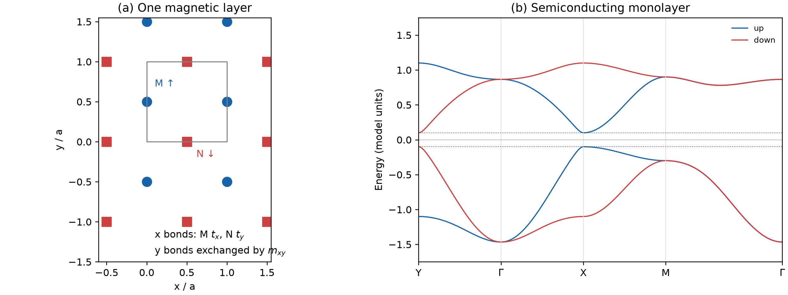
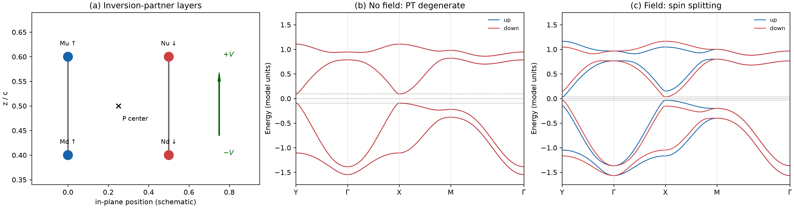
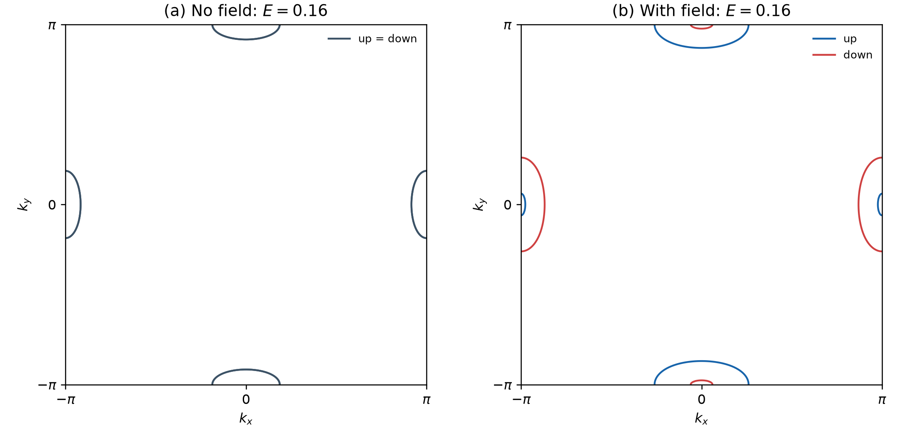
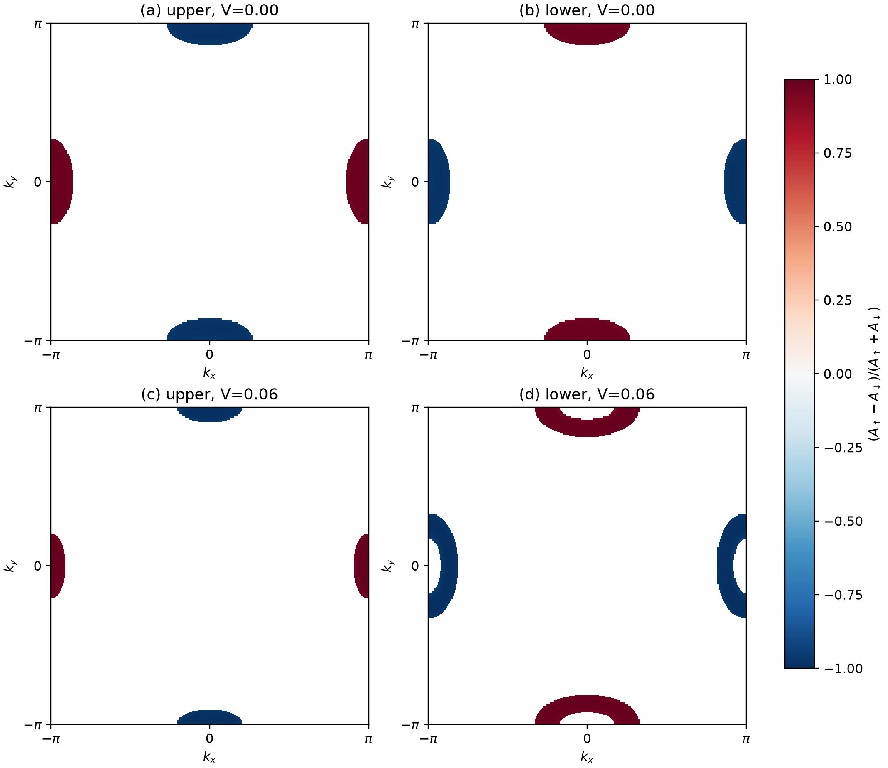

# Electric-Field-Activated Spin Splitting in a Bilayer Altermagnetic Semiconductor

A single altermagnetic layer can have momentum-dependent spin splitting without a net magnetization. Stack two such layers as inversion partners, however, and the *total* bilayer bands can become spin degenerate: the spin polarization is hidden in the individual layers. A perpendicular electric field gives the layers different electrostatic potentials, breaks the symmetry responsible for that degeneracy, and makes the splitting visible again.

This repository walks through that mechanism using a minimal, runnable **one-orbital tight-binding model**. It is a qualitative model, not a first-principles fit to a particular material. Spin–orbit coupling (SOC) is omitted, so spin up and spin down are exact labels. All energies are in model units. The parameters are chosen so that the monolayer, the zero-field bilayer, and the field-biased bilayer all remain semiconducting.

## 1. Start with one magnetic layer

Set the square-lattice constant to $a=1$. A unit cell contains two magnetic sites: $M=(0,1/2)$ with an up moment and $N=(1/2,0)$ with a down moment. Retain one effective $d$ orbital per site. The square in Fig. 1(a) marks a translational unit cell; the lattice extends beyond it.



Along $x$, hopping between like $M$ sites is $t_x$, whereas hopping between like $N$ sites is $t_y$. Along $y$, these values are interchanged. Thus the spatial operation $m_{xy}:(x,y)\mapsto(y,x)$ exchanges the two sublattices and their directional hoppings. The nearest diagonal M–N hopping is $t_{MN}$. Figure 1(b) shows the resulting bands along $Y\to\Gamma\to X\to M\to\Gamma$.

Use the basis $(|M,\uparrow\rangle,|N,\uparrow\rangle,|M,\downarrow\rangle,|N,\downarrow\rangle)$. Without SOC the Hamiltonian separates into two $2\times2$ blocks. With $s=+1$ for up and $s=-1$ for down, and Pauli matrices $\tau_i$ acting on $(M,N)$,

$$
H_s^{\mathrm{mono}}(\mathbf k)
=\epsilon_0(\mathbf k)\tau_0+g(\mathbf k)\tau_x
+[d(\mathbf k)-s\Delta]\tau_z,
$$

where

$$
\begin{aligned}
\epsilon_0(\mathbf k)&=-(t_x+t_y)(\cos k_x+\cos k_y),\\
d(\mathbf k)&=-(t_x-t_y)(\cos k_x-\cos k_y),\\
g(\mathbf k)&=-4t_{MN}\cos(k_x/2)\cos(k_y/2).
\end{aligned}
$$

The exchange term $-s\Delta\tau_z$, with $\Delta>0$, favors up spin on $M$ and down spin on $N$. The $g$ term mixes the two sublattices. Its real form uses a convenient Bloch gauge; a different gauge can change matrix phases but not the spectrum.

| $t_x$ | $t_y$ | $t_{MN}$ | $\Delta$ |
|---:|---:|---:|---:|
| 0.20 | −0.05 | 0.25 | 0.60 |

The negative $t_y$ is the sign of an effective orbital hopping, not a negative distance. On a $301\times301$ momentum grid, the half-filled monolayer has valence-band maximum (VBM) $-0.1000$, conduction-band minimum (CBM) $+0.1000$, and an indirect gap of $0.2000$.

Exchanging $k_x$ and $k_y$, exchanging $M$ and $N$, and reversing spin leaves the spectrum invariant. Nevertheless, up and down bands can differ at a *fixed generic* $\mathbf k$. Their roles interchange between $X=(\pi,0)$ and $Y=(0,\pi)$, producing a d-wave-like momentum pattern; they coincide on $k_x=k_y$. Here “d-wave-like” describes the sign structure of the spin splitting, **not** superconducting pairing.

## 2. Stack inversion-partner layers

Label the layers $u$ and $d$. Their sites and moments are:

| Site | Fractional position | Moment |
|---|---|---|
| $M_u$ | $(0,1/2,0.6)$ | $\uparrow$ |
| $N_u$ | $(1/2,0,0.6)$ | $\downarrow$ |
| $M_d$ | $(0,1/2,0.4)$ | $\uparrow$ |
| $N_d$ | $(1/2,0,0.4)$ | $\downarrow$ |

Inversion about $(1/4,1/4,1/2)$ exchanges $M_u\leftrightarrow N_d$ and $N_u\leftrightarrow M_d$. Consequently, the lower layer must use the *inversion-partner* hopping anisotropy: its $d(\mathbf k)$ term has the opposite sign in the basis below. Simply copying every upper-layer matrix element to the lower layer would not give the intended symmetry. Keep only vertical hoppings between $M_u$ and $M_d$, and between $N_u$ and $N_d$, both equal to $-t_\perp$.

For each spin, in the basis $(M_u,N_u,M_d,N_d)$,

$$
H_s^{\mathrm{bi}}(\mathbf k;V)=
\begin{pmatrix}
\epsilon_0+d-s\Delta+V & g & -t_\perp & 0\\
g & \epsilon_0-d+s\Delta+V & 0 & -t_\perp\\
-t_\perp & 0 & \epsilon_0-d-s\Delta-V & g\\
0 & -t_\perp & g & \epsilon_0+d+s\Delta-V
\end{pmatrix}.
$$

All $\epsilon_0,d,g$ entries are evaluated at the same $\mathbf k$. The perpendicular-field term is a **layer-dependent electrostatic potential**,

$$
H_E=V\lambda_z,\qquad \lambda_z=\mathrm{diag}(1,1,-1,-1).
$$

The upper and lower onsite shifts are $+V$ and $-V$, so their difference is $2V$. This term neither flips spin nor represents a Zeeman field. We use $t_\perp=0.08$ and compare $V=0$ with $V=0.06$.



Figure 2(a) schematically separates the layers; its horizontal coordinate is not a complete drawing of the two-dimensional positions listed above. In Fig. 2(b), the blue and red bands coincide at zero field. The field in Fig. 2(c) separates them at generic momenta, but not everywhere.

## 3. Why does the field reveal the splitting?

Time reversal $T=i s_yK$ flips spin and momentum, where $K$ is complex conjugation. Spatial inversion $P$ also flips momentum and exchanges inversion-partner sites. Their product $PT$ therefore leaves $\mathbf k$ unchanged. In our Bloch gauge and site ordering, the orbital part of inversion is

$$
P_{\mathrm{orb}}=
\begin{pmatrix}
0&0&0&1\\
0&0&1&0\\
0&1&0&0\\
1&0&0&0
\end{pmatrix}.
$$

Direct substitution gives

$$
P_{\mathrm{orb}}H_{\uparrow}^{\mathrm{bi}}(\mathbf k;0)P_{\mathrm{orb}}^{-1}
=H_{\downarrow}^{\mathrm{bi}}(\mathbf k;0).
$$

For spin one-half, $(PT)^2=-1$, so the two spin sectors have paired eigenvalues at each $\mathbf k$. **This is a statement about the full bilayer, not about the spin character of either layer separately.** At zero field, $PT$ relates up-spin spectral weight in one layer to down-spin spectral weight in the other: the layer-resolved patterns cancel in the total spectrum.

Inversion exchanges the layers and hence sends $\lambda_z\mapsto-\lambda_z$. More precisely,

$$
P_{\mathrm{orb}}H_{\uparrow}^{\mathrm{bi}}(\mathbf k;V)P_{\mathrm{orb}}^{-1}
=H_{\downarrow}^{\mathrm{bi}}(\mathbf k;-V),
$$

which is **not** $H_{\downarrow}^{\mathrm{bi}}(\mathbf k;V)$ for fixed nonzero $V$. The electric field breaks $PT$, removing the requirement of spin degeneracy. A combined operation that swaps $k_x,k_y$ and $M/N$ while reversing spin still relates the $X$ and $Y$ responses. Thus the field reveals a momentum-dependent, altermagnetic-like splitting rather than a uniform same-sign splitting; the bands remain degenerate on the Gamma–M diagonal.

## 4. Constant-energy contours and hidden layer polarization

An intrinsic semiconductor has **no Fermi surface when its chemical potential lies in the gap**. To visualize the conduction-band spin texture, Fig. 3 instead cuts the bands at $E=0.16$. These contours could be interpreted as Fermi contours *if* electron doping or gating placed the chemical potential there; they are not the Fermi surface of the undoped half-filled model.



At zero field [Fig. 3(a)] the up- and down-spin contours coincide, so one color represents both. Under the field [Fig. 3(b)] the blue and red contours separate near $X/Y$, with the spin order exchanged between the two valleys. Pockets cut by a Brillouin-zone boundary close under periodic continuation; they are not open Fermi surfaces.

To see where the spin information was hidden, compute the spin-resolved spectral weight $A_{\ell s}(\mathbf k,E)$ on each layer $\ell$ near $E=0.16$, using Lorentzian broadening $\eta=0.02$. The plotted layer polarization is

$$
\mathcal P_\ell(\mathbf k,E)=
\frac{A_{\ell\uparrow}(\mathbf k,E)-A_{\ell\downarrow}(\mathbf k,E)}
{A_{\ell\uparrow}(\mathbf k,E)+A_{\ell\downarrow}(\mathbf k,E)}.
$$



Figures 4(a,b) show the zero-field layers: the red and blue regions reverse between upper and lower layers even though the full bands remain spin degenerate. With the field [Figs. 4(c,d)], the two layer-resolved distributions are no longer constrained to have equal and opposite weight. White marks regions whose spectral weight at this energy is below the display threshold; it does **not** prove exactly zero spin polarization there.

## 5. Numerical checks and scope

The script finds the half-filled band edges on a $301\times301$ momentum grid:

| System | VBM | CBM | Indirect gap |
|---|---:|---:|---:|
| Monolayer | −0.10000 | +0.10000 | 0.20000 |
| Bilayer, $V=0$ | −0.09364 | +0.09364 | 0.18728 |
| Bilayer, $V=0.06$ | −0.03431 | +0.03431 | 0.06863 |

The field narrows but does not close the semiconductor gap for these parameters. The largest zero-field up/down band difference is approximately $2.4\times10^{-15}$; the zero-field $PT$ matrix error is zero. At fixed $V=0.06$, the $PT$ matrix difference is $0.12=2V$. These are algebraic and floating-point checks of the model, **not experimental uncertainties**.

Applying the model quantitatively to a real material would require its actual orbitals and atomic environment, SOC, structural relaxation, electric-field screening, and a chemical potential determined at fixed carrier density. A one-orbital sketch alone cannot establish every spatial symmetry of a complete crystal, such as a Janus layer. The supported conclusion is narrower: **for the specified inversion-partner bilayer, $PT$ enforces zero-field spin degeneracy; a layer potential breaks $PT$ and exposes momentum-dependent spin splitting while this chosen parameter set remains semiconducting.**

## Reproduce the figures

Install Python, NumPy, and Matplotlib, then run:

```bash
python altermag_bilayer.py
```

The [model script](altermag_bilayer.py) creates `assets/` with four figures and `data/` with plain-text numerical arrays. Its `*_bands.txt` files contain high-symmetry-path bands; `*_grid.txt` files contain two-dimensional eigenvalues; and `*_upper_spectral.txt`/`*_lower_spectral.txt` contain layer spectral weights and polarizations. The grid uses $k_x$ as the inner and $k_y$ as the outer index. The TXT files are generated locally when the script runs; only the script, README, and four displayed figures are included in this repository.
